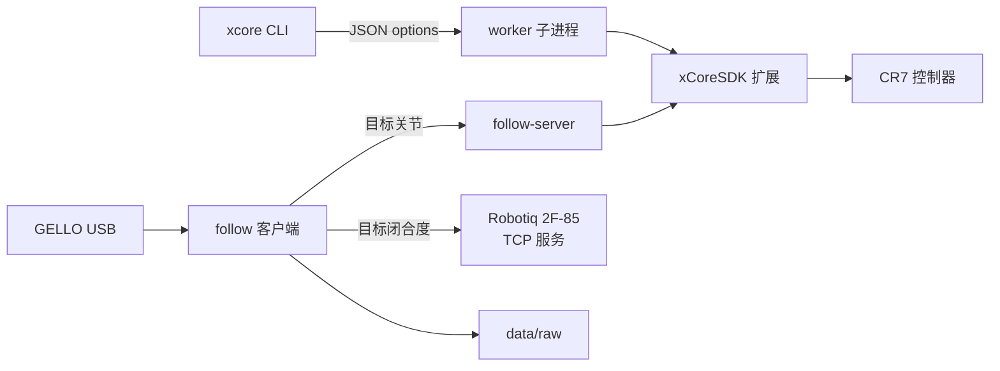

# 架构与数据流

xcore-sdk-python 是 CR7 的命令行入口和实时跟随实现。它同时负责：
厂商 SDK 的安全封装、GELLO 主臂读取与映射、六轴实时目标流、夹爪独立跟随、
raw episode 记录和退出返回。

## 进程边界

- `cli.py` 解析参数并加载 `config/default.toml`。
- 只读查询在 `worker.py` 隔离子进程中调用厂商扩展，避免会话状态泄漏。
- `follow-server` 常驻，负责 RT 运动与看门狗；`follow` 客户端读取主臂并发送目标。
- `follow-prepare` 与 `return-pose` 使用独立 SDK 会话完成启动对齐和退出返回。
- 夹爪不经过 CR7 SDK，直接走远端 TCP 服务。

同一时刻只允许一个跟随／对齐／退出返回会话；应用锁位于
`xcore-sdk-python/.follow.lock`。锁文件存在本身不代表被持有。

## 控制与限速

- 客户端默认按 `follow.hz`（50 Hz）读取主臂并发送六轴目标。
- 服务端按 `server.max_speed_deg`（软件上限 75 °/s）和
  `server.accel_deg_s2`（40 °/s²）限制 RT 目标。
- `prepare.speed` 是启动对齐的 SDK 速度参数（mm/s），不是轴速度。
- 起始真机姿态和目标都必须通过 `follow_limits.py` 的限位交集检查。

## 数据

`follow --raw-data-root ...` 记录从臂**实际反馈**，不是目标角。raw v1 行包含
序号、命令/反馈时间、目标、关节位置/速度和夹爪反馈；未保存片段保持
`.partial`。退出返回和故障恢复不写入 episode。

转换由 `lerobot-converter` 的独立 Python 3.12 环境完成，本包不导入转换依赖。

## 安全状态

- 只读命令不发送运动。
- `follow-server` 默认 dry-run；只有显式 `--enable-motion` 才接受运动目标。
- 退出默认返回保存姿态；`--no-return` 禁止返回，显式 `--zero` 才回六轴零位。
